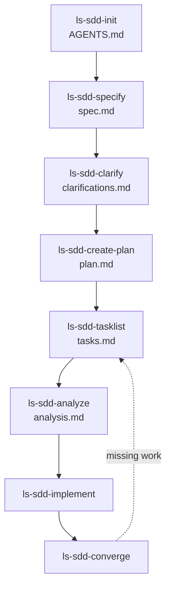

# ls-sdd-skills

A collection of Zed agent skills for **Spec-Driven Development (SDD)**. The skills guide an agent through a structured workflow: Constitution → Spec → Clarify → Plan → Tasks → Analyze → Implement → Converge.

The skills are **generic** (not tied to a specific project) and are installed globally under `~/.agents/skills/`. They carry the `ls-` prefix (Leonard Siebeneicher) for namespacing and recognition.

Inspired by [GitHub Spec Kit](https://github.com/github/spec-kit) and [BMAD-METHOD](https://github.com/bmad-code-org/BMAD-METHOD), adapted without adopting their full complexity.

## Skill Set (9 Skills)

| Skill | Purpose |
|---|---|
| `ls-sdd` | Meta-skill: workflow overview, conventions, "what's next?" |
| `ls-sdd-init` | Create/update the project constitution in `AGENTS.md` |
| `ls-sdd-specify` | Create a functional specification (what & why, not how) |
| `ls-sdd-clarify` | Structured clarification before planning (surface gaps) |
| `ls-sdd-create-plan` | Create a plan from one or more specs (N:M) |
| `ls-sdd-tasklist` | Generate tasks from a plan (with dependencies) |
| `ls-sdd-analyze` | Cross-artifact consistency check (spec ↔ plan ↔ tasks) |
| `ls-sdd-implement` | Execute tasks in order |
| `ls-sdd-converge` | Compare codebase against specs/plans, append missing tasks |

## Installation

These skills are designed to be installed globally so they are available in every project.

### Option A: Manual clone

```sh
git clone <this-repo> ~/path/to/ls-sdd-skills
# then symlink each skill into the global skills directory:
ln -s "$PWD/ls-sdd"            ~/.agents/skills/ls-sdd
ln -s "$PWD/ls-sdd-init"       ~/.agents/skills/ls-sdd-init
ln -s "$PWD/ls-sdd-specify"    ~/.agents/skills/ls-sdd-specify
ln -s "$PWD/ls-sdd-clarify"    ~/.agents/skills/ls-sdd-clarify
ln -s "$PWD/ls-sdd-create-plan" ~/.agents/skills/ls-sdd-create-plan
ln -s "$PWD/ls-sdd-tasklist"   ~/.agents/skills/ls-sdd-tasklist
ln -s "$PWD/ls-sdd-analyze"    ~/.agents/skills/ls-sdd-analyze
ln -s "$PWD/ls-sdd-implement"  ~/.agents/skills/ls-sdd-implement
ln -s "$PWD/ls-sdd-converge"   ~/.agents/skills/ls-sdd-converge
```

### Option B: `npx skills add`-compatible

Each skill directory follows the standard Zed skill layout (`SKILL.md` with YAML frontmatter + optional supporting files), so it can be added with any compatible skill registry tooling.

## Workflow



## Conventions (Single Source of Truth)

All directory structure, frontmatter, status, slug, and ID conventions are defined **once** in the `ls-sdd` meta-skill. The other skills reference it rather than duplicating the rules. See [`ls-sdd/SKILL.md`](ls-sdd/SKILL.md) for the full convention set.

## Language

- Skill bodies (`SKILL.md`): **English** (standard in the skills ecosystem, better discoverability).
- Generated artifacts (specs, plans, tasks, clarifications, analysis, convergence reports): the **project's artifact language**, declared in `AGENTS.md` by `ls-sdd-init`. This is a project property, independent of the conversation language — a German-speaking user may run an English-language project.

## Research Delegation

Exploratory codebase searches and concrete external-documentation questions may be delegated to read-only research subagents. This is information gathering only: the main session retains user communication, decisions, evidence assessment, synthesis, and responsibility for SDD artifacts. Normal required reading and known, task-relevant code sections may remain in the main session. Research delegation is not a new workflow phase and does not enable automatic parallel implementation; it is independent of the `[P]` task marker.

This requires an agent session with subagent support. If that support is unavailable, the skill must say so and ask whether the user authorizes a bounded direct-research fallback or prefers to defer the affected step. It must not silently perform exploratory direct research. No new research artifact is required; raw research and subagent transcripts are not recorded automatically. No cost or token savings are assumed; those require measurement.

## Scope

Global under `~/.agents/skills/`. SDD is project-independent.

## Out of Scope

- No CLI – skills are pure Markdown instructions for Zed (and compatible agents).
- No own skill registry – use `npx skills` / skills.sh.
- No automation beyond Zed (no GitHub Actions, no CI).
- No automatic multi-agent implementation orchestration (such as BMAD "party mode"). Delegated read-only information gathering is supported as described above.
- No UI for the workflow – the agent guides the user.
