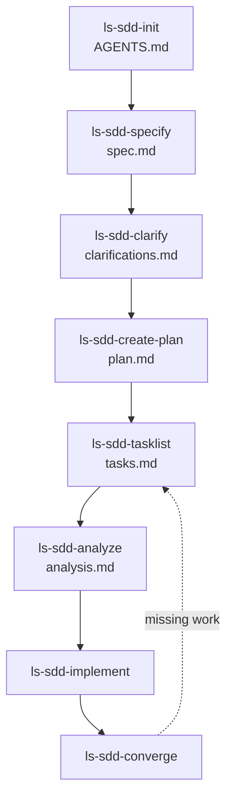

# ls-sdd — Spec-Driven Development (Meta-Skill)

This is the **single source of truth** for the `ls-sdd-*` skill family. It
defines the workflow, the directory layout, the frontmatter models, the status
machines, the slug/ID conventions, and the "what's next?" logic.

All other `ls-sdd-*` skills **must** reference this skill for format details
instead of duplicating the conventions. If you are running another `ls-sdd-*`
skill, read this file first for the conventions, then proceed.

## Workflow



| Phase | Skill | Produces | Spec status | Plan status |
|---|---|---|---|---|
| 0 | `ls-sdd-init` | `AGENTS.md` | — | — |
| 1 | `ls-sdd-specify` | `specs/NNNN-spec-slug/spec.md` | `draft` | — |
| 2 | `ls-sdd-clarify` | `specs/NNNN-spec-slug/clarifications.md` | `clarified` | — |
| 3 | `ls-sdd-create-plan` | `plans/NNNN-slug/plan.md` | `planned` | `planned` |
| 4 | `ls-sdd-tasklist` | `plans/NNNN-slug/tasks.md` | `planned` | `tasked` |
| 5 | `ls-sdd-analyze` | `plans/NNNN-slug/analysis.md` | `planned` | `analyzed` |
| 6 | `ls-sdd-implement` | (code changes, task checkboxes) | `planned` | `implementing` → `done` |
| 7 | `ls-sdd-converge` | appended tasks in `tasks.md` | `planned` | `implementing` |

## Directory Layout (in target projects)

```
[project]/
├── AGENTS.md                    # Constitution (project-wide, from ls-sdd-init)
├── plans/
│   └── 001-[identity]/
│       ├── plan.md
│       ├── tasks.md
│       └── [research.md, analysis.md]   # optional
└── specs/
    ├── 001-spec-[identity]/
    │   ├── spec.md
    │   ├── clarifications.md            # from ls-sdd-clarify
    │   └── [additional markdown files]  # e.g. menu.md, data-model.md
    └── 002-spec-[identity]/
        └── spec.md
```

### Conventions

- `AGENTS.md` holds the **constitution** — read automatically by Zed / Claude Code / Cursor.
- Plans and Specs have **separate** ID sequences. Plan `001` and Spec `001` can both exist.
- **Plan slug**: `001-identity` (no `-plan-` marker).
- **Spec slug**: `001-spec-identity` (with `-spec-` marker to distinguish from plans).
- Plans and Specs are **N:M coupled**: a plan references spec IDs in its frontmatter (`specs: [0001, 0002]`).
- Additional markdown files per spec are allowed (e.g. `menu.md`, `data-model.md`).

## ID & Slug Format

- **Spec ID**: 4-digit zero-padded number, e.g. `0001`. Used in frontmatter `id:` and in references.
- **Plan ID**: 4-digit zero-padded number, e.g. `0001`. Independent sequence from specs.
- **Task ID**: `T` + 4-digit number, e.g. `T0001`. Unique within a `tasks.md`.
- **Slug**: lowercase kebab-case identifier, e.g. `auth-login`, `pdf-export`.
- **Directory name**:
  - Spec: `NNNN-spec-<slug>` (e.g. `001-spec-auth-login`)
  - Plan: `NNNN-<slug>` (e.g. `001-auth-login`)

### ID Assignment

When creating a new spec or plan, **scan the relevant directory** (`specs/` or `plans/`) and use `max(existing_ids) + 1`. Never assume the next ID — always derive it from the filesystem. If the directory is empty, start at `0001`.

## Frontmatter Models

### Spec (`specs/NNNN-spec-slug/spec.md`)

```yaml
---
id: 0001
slug: identity
created: 2026-07-01T14:30
status: draft          # draft | clarified | planned | superseded | done
scale: standard        # trivial | standard | enterprise
parent: null           # ID of predecessor when a spec is revised
---
```

### Plan (`plans/NNNN-slug/plan.md`)

```yaml
---
id: 0001
slug: identity
created: 2026-07-01T14:30
status: draft          # draft | planned | tasked | analyzed | implementing | done | superseded
specs: [0001, 0002]    # referenced spec IDs
parent: null
---
```

### Tasks (`plans/NNNN-slug/tasks.md`)

```yaml
---
id: 0001
plan: 0001
created: 2026-07-01T14:30
status: draft          # draft | in-progress | blocked | done
---
```

## Status Machines

- **Spec**: `draft → clarified → planned → done` (with `superseded` as terminal on revision)
- **Plan**: `draft → planned → tasked → analyzed → implementing → done` (with `superseded`)
- **Task**: per-task `- [ ]` (open) / `- [x]` (done) / `- [~]` (blocked)

## Task Format

Checkbox list with metadata, parsable by the agent:

```markdown
- [ ] T0001 Provider-Trait definieren
  - depends: -
  - files: src/provider/mod.rs
  - acceptance: Trait mit complete(), stream()

- [P] T0002 Provider-Impl für OpenAI
  - depends: T0001
  - files: src/provider/openai.rs
  - acceptance: OpenAI-Provider implementiert das Trait
```

- `- [ ]` open · `- [x]` done · `- [~]` blocked
- `[P]` after the checkbox marks a task as **parallelizable** (can run alongside other `[P]` tasks once their `depends:` are satisfied).
- `depends:` lists task IDs that must be done first, or `-` for none.
- `files:` lists the files this task will create or modify.
- `acceptance:` states the verifiable condition for "done".

## Scale-Adaptive Depth

`ls-sdd-specify` asks the user about the scale of the work:

- **trivial** (bugfix, small tweak): minimal spec, skip plan, go straight to a task list.
- **standard** (feature, new module): full spec → plan → tasks.
- **enterprise** (system, multiple teams): spec with non-functional requirements, architecture plan, tasks with dependencies.

The chosen scale is recorded in the spec frontmatter (`scale:`) and influences how much detail downstream skills request.

## Language

Artifact language is a **project property**, not derived from the
conversation language. The user may speak German with the agent while the
project itself is English-language (code, comments, docs).

- **Skill bodies** (`SKILL.md`): **English** (standard in the skills
  ecosystem, better discoverability via `npx skills find`).
- **Generated artifacts** (specs, plans, tasks, clarifications, analysis,
  convergence reports): the **project's artifact language**, as declared in
  `AGENTS.md` by `ls-sdd-init`.

### How the artifact language is determined

1. **Constitution declares it** — `ls-sdd-init` asks the user once and writes
   it into `AGENTS.md` (e.g. `Artifact language: English` or `German`).
2. **Existing artifacts confirm it** — when creating a new spec/plan, the
   skill reads existing artifacts in the project and matches their language.
3. **Fallback: ask once** — if `AGENTS.md` is silent and no artifacts exist,
   the skill asks the user once, then recommends running `ls-sdd-init` to
   record the choice.

The conversation language only affects how the agent *talks to the user*, not
what it writes into files.

## Templates

Canonical templates live as files in this skill's directory. Reference them
instead of inlining:

- [`templates/spec.template.md`](templates/spec.template.md)
- [`templates/plan.template.md`](templates/plan.template.md)
- [`templates/tasks.template.md`](templates/tasks.template.md)

When creating an artifact, read the matching template, substitute the
`{{placeholders}}`, and write the result to the target path.

## "What's Next?" Logic

When the user asks "what's next?" or invokes `ls-sdd` without a specific
request, scan the project and recommend the next step:

1. **No `AGENTS.md`?** → recommend `ls-sdd-init`.
2. **No `specs/` or specs all in `draft`?** → recommend `ls-sdd-specify` (or `ls-sdd-clarify` if a draft exists).
3. **Specs in `clarified` but no plan referencing them?** → recommend `ls-sdd-create-plan`.
4. **Plan in `planned` but no `tasks.md`?** → recommend `ls-sdd-tasklist`.
5. **Plan in `tasked` but no `analysis.md`?** → recommend `ls-sdd-analyze`.
6. **Plan in `analyzed`?** → recommend `ls-sdd-implement`.
7. **Plan in `implementing` with open tasks?** → recommend continuing `ls-sdd-implement`.
8. **Plan in `done` but codebase drifted?** → recommend `ls-sdd-converge`.

Present a short status table:

```
Specs:
  0001  auth-login        draft       scale=standard
Plans:
  0001  auth-login        tasked      specs=[0001]
Tasks:
  0001  plan=0001         3 open / 2 done / 0 blocked
```

Then state the recommended next skill and why.

## Cross-Skill References

Every `ls-sdd-*` skill begins its body with a pointer back to this file:

> **Conventions**: Read the `ls-sdd` meta-skill for directory structure, frontmatter, status, slug, and ID format. This skill does not duplicate them.

This prevents convention drift. If a convention changes, update it here only.
