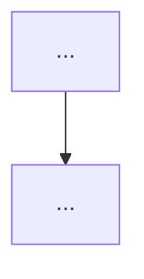

# Plan: {{Title}}

> A plan describes **how** to build what the referenced spec(s) define. It
> covers architecture, modules, dependencies, risks, and trade-offs. It does
> **not** contain the task list (that is `tasks.md`).

## Referenced Specs

- {{spec-id}} – {{spec-slug}}

## Goal

One-paragraph summary of what this plan achieves.

## Architecture

How will the system be structured? Modules, layers, key abstractions, data
flow. Include a diagram if it helps.

## Modules / Components

| Module | Responsibility | Touches |
|---|---|---|
| ... | ... | new / existing |

## Dependencies

External libraries, internal modules, services. Note version constraints.

## Risks & Trade-offs

- **R1**: ... — mitigation: ...
- **R2**: ... — mitigation: ...

## Open Questions

- ...

## Research Notes

Optional. If tech-stack research was done, summarize here or link to
`research.md` in the same directory.
